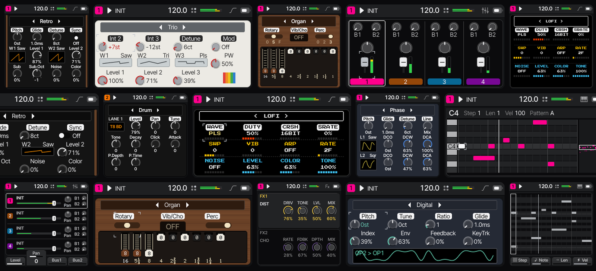

# Fune

A small music studio for multiple platforms

<a href="https://hugelton.itch.io/fune"></a>



**Status: 0.0.1 Alpha, in development.** Song and preset files may still change between builds.

**Install on an FM-1**: the [web installer](https://hugelton.com/fune/install/) (Chrome or Edge on a computer, over USB).

| Platform | Status |
| --- | --- |
| M-VAVE FM-1 | Beta |
| M-VAVE SMK-37 Pro / Elite | Alpha |
| macOS, Linux | Planned |
| Web (desktop, tablet) | Planned |
| M5Stack Cardputer Zero | Alpha |
| H700 handhelds (PortMaster) | Planned |

## Features

- **Sequencer**: 16 steps, four patterns a track; a piano roll, a step grid, drum lanes and a tracker view; songs of up to 256 scenes
- **Synths**: Retro, Phase, Trio, Lofi, Organ and Digital, each with its own panel
- **Drums**: eight lanes of synthesised pieces a kit
- **Effects**: two inserts a track from fifteen, two send buses, a mixer
- **Presets and songs**: factory and user presets, songs saved on the device
- **Tools**: fill, Euclid, random, shift, humanize, reverse, Dynamite, undo
- **MIDI**: in and out, clock sync, MIDI learn on a computer
- **Plugins**: synth engines and effects from outside the core (an SDK)

## Before you install on an FM-1

- Fune runs only with M-VAVE's own (stock) bootloader. On a modified bootloader it refuses to write anything.
- It has been tested on FM-1 units with the earlier flash chip only; units with the newer chip should work but are untested.
- Fune is not compatible with Felucca or the custom firmwares derived from it: songs, presets and plugins do not carry over.
- To go back, install M-VAVE's official firmware with their updater.

## Build

```bash
cmake -S . -B build && cmake --build build -j8
ctest --test-dir build
open build/Fune.app      # macOS; ./build/kreisel elsewhere
```

Needs CMake, a C11 compiler, SDL2 and Python 3 with Pillow and fontTools. The FM-1 image: `bash platforms/fm1hw/build.sh`
(Docker). More: [docs/README.md](docs/README.md) (the manual, installing on the FM-1, plugins).

## Credits and licence

[MPL-2.0](LICENSE); the plugin SDK and the example plugins MIT; the documentation CC BY 4.0; the third-party parts keep their
own ([LICENSING.md](LICENSING.md)). Thanks: [CREDITS.md](CREDITS.md). The name and the logo: [TRADEMARK.md](TRADEMARK.md).

M-VAVE, FM-1 and SMK-37 are trademarks of their respective owners. Fune is not affiliated with or endorsed by them.

Copyright (C) 2026 Leo Kuroshita (@kurogedelic), Hügelton Instruments
